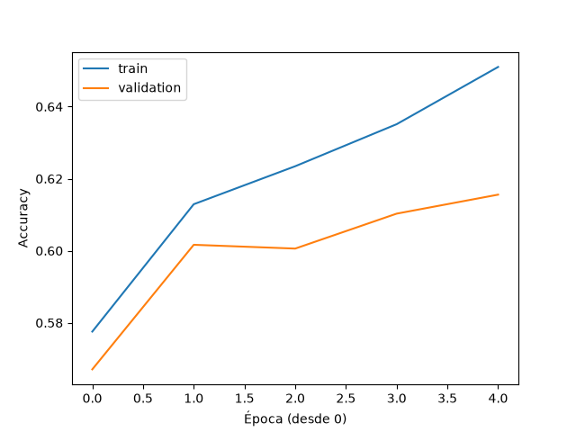
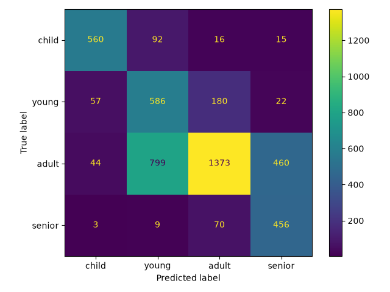

# Informe: estimación de rango etario con UTKFace

## Objetivo y método

Se clasificaron imágenes faciales en cuatro categorías: **niño (0–12), joven (13–25), adulto (26–59) y mayor (60+)**. Se respetaron los límites de la descripción del ejercicio, corrigiendo el corte en 50 años del ejemplo.

Se utilizó UTKFace cropped, con imágenes RGB redimensionadas a 128×128 y normalizadas a [-1, 1]. El programa utiliza MobileNetV2 preentrenada en ImageNet como extractor congelado, seguida de pooling global, una capa de 128 unidades ReLU, dropout de 0,3 y cuatro salidas softmax. El entrenamiento emplea Adam, entropía cruzada, aumento horizontal y ponderación inversa a la frecuencia de clase.

Se analizaron **23.708 imágenes**, sin archivos rechazados según `rejected.json`. La división estratificada fue de 14.224 imágenes para entrenamiento, 4.742 para validación y 4.742 para prueba, con semilla 42. Se ejecutaron cinco épocas con TensorFlow 2.21.0. El conjunto de prueba queda reservado para la evaluación final; early stopping solo consulta validación.

| Clase | Entrenamiento | Validación | Prueba |
|---|---:|---:|---:|
| Niño | 2.047 | 683 | 683 |
| Joven | 2.534 | 845 | 845 |
| Adulto | 8.029 | 2.676 | 2.676 |
| Mayor | 1.614 | 538 | 538 |
| Total | 14.224 | 4.742 | 4.742 |

## Resultados

Las métricas siguientes proceden de los archivos del primer entrenamiento aportados al repositorio. Se recalcularon desde `predictions.csv` y coinciden con `metrics.json`. También se verificaron las etiquetas a partir de las edades, la existencia de las imágenes y la ausencia de nombres de archivo compartidos entre particiones. **No se repitió el entrenamiento ni la inferencia**: el modelo entrenado no está incluido en el repositorio.

- **Accuracy de prueba: 62,74 %**, con 2.975 aciertos sobre 4.742 imágenes.
- **F1 macro: 64,56 %**; F1 ponderado: 63,79 %.
- Precision macro: 63,85 %; recall macro: 71,85 %.

Accuracy representa el porcentaje total de aciertos. Precision por clase indica qué proporción de las predicciones de esa clase fue correcta; recall indica qué proporción de sus ejemplos reales se recuperó.

| Clase | Precision | Recall | F1 | Imágenes de prueba |
|---|---:|---:|---:|---:|
| Niño | 84,34 % | 81,99 % | 83,15 % | 683 |
| Joven | 39,43 % | 69,35 % | 50,28 % | 845 |
| Adulto | 83,77 % | 51,31 % | 63,64 % | 2.676 |
| Mayor | 47,85 % | 84,76 % | 61,17 % | 538 |

Como referencia, predecir siempre «adulto» obtendría 56,43 % de accuracy en esta prueba. El modelo supera esa referencia en 6,30 puntos porcentuales; esta comparación muestra por qué también es necesario observar las métricas por clase.

### Evolución del entrenamiento

La accuracy de entrenamiento aumentó de 57,75 % a 65,10 %, y la de validación de 56,71 % a 61,56 %. La pérdida de validación pasó de 0,8692 a 0,7912, con una pequeña subida en la cuarta época. La diferencia final de accuracy entre entrenamiento y validación fue de 3,54 puntos porcentuales. Estas cinco épocas no muestran una divergencia sostenida pronunciada, aunque tampoco permiten descartar sobreajuste ni establecer que el entrenamiento haya convergido.

### Matriz de confusión

Filas: clase real. Columnas: clase predicha.

| Real / Predicha | Niño | Joven | Adulto | Mayor |
|---|---:|---:|---:|---:|
| Niño | 560 | 92 | 16 | 15 |
| Joven | 57 | 586 | 180 | 22 |
| Adulto | 44 | 799 | 1.373 | 460 |
| Mayor | 3 | 9 | 70 | 456 |

La mayor confusión ocurre entre adultos y jóvenes: 799 adultos fueron clasificados como jóvenes. Otros 460 adultos se clasificaron como mayores. Esto contribuye a la baja precision de las predicciones «joven» y «mayor», aunque sus recalls sean más altos. Niño presenta el mejor F1 de las cuatro clases. El balanceo de clases busca favorecer categorías menos frecuentes, pero estos resultados por sí solos no permiten atribuirle causalmente las confusiones; haría falta comparar con un entrenamiento sin ponderación.

## Conclusiones y limitaciones

El modelo ofrece una primera solución funcional para clasificar rangos etarios, con 62,74 % de accuracy en el conjunto de prueba. El desempeño es desigual: niño alcanza F1 de 83,15 %, mientras joven obtiene 50,28 %. La mejora sobre la referencia mayoritaria es moderada y los errores adulto/joven y adulto/mayor son los principales puntos a investigar.

UTKFace está desbalanceado y puede presentar sesgos de representación y errores en las edades anotadas. La separación por archivos no garantiza independencia de identidades ni ausencia de imágenes visualmente duplicadas. Por tanto, la generalización a personas nuevas puede ser inferior a estas métricas. Los cortes de edad también crean fronteras difíciles para un modelo basado únicamente en apariencia facial. El experimento no determina la edad real ni acredita mayoría de edad.

Como mejoras futuras, se recomienda analizar errores cerca de los cortes, evaluar particiones independientes por identidad cuando sea posible y comparar estrategias de balanceo o fine-tuning usando únicamente validación para elegirlas. Cualquier prueba adicional con diez rostros conocidos debe presentarse separadamente, con la edad al tomar la fotografía y sin usar imágenes de entrenamiento.

## Estado de la entrega y reproducción

El repositorio incluye código, dataset, particiones, predicciones, métricas y gráficos; este informe completa el entregable escrito con los resultados disponibles. No es necesario volver a entrenar para redactar las conclusiones anteriores.

El archivo `artifacts/model.keras` no está en el repositorio porque `*.keras` está excluido por Git. Para nuevas predicciones o para verificar la inferencia se necesita conservar y facilitar el modelo original, o realizar otro entrenamiento y documentarlo como un experimento nuevo. Los CSV del primer entrenamiento contienen rutas de la computadora donde se ejecutó; esas rutas deben adaptarse al cambiar de máquina. Se verificó la correspondencia con las imágenes locales por nombre de archivo, sin modificar los resultados originales.
